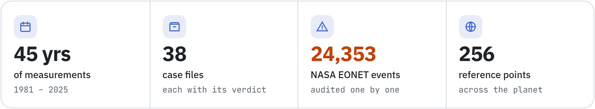
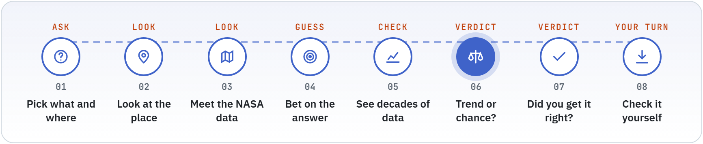
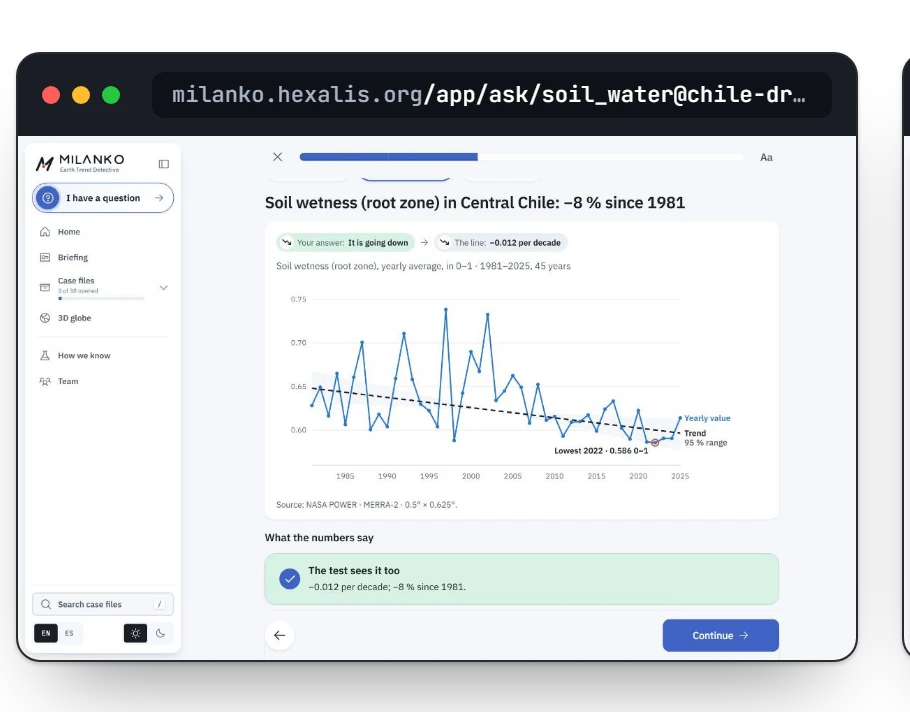
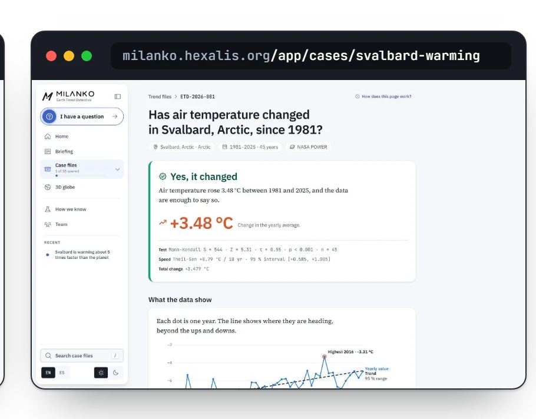
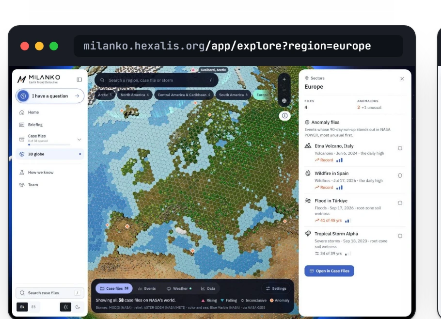
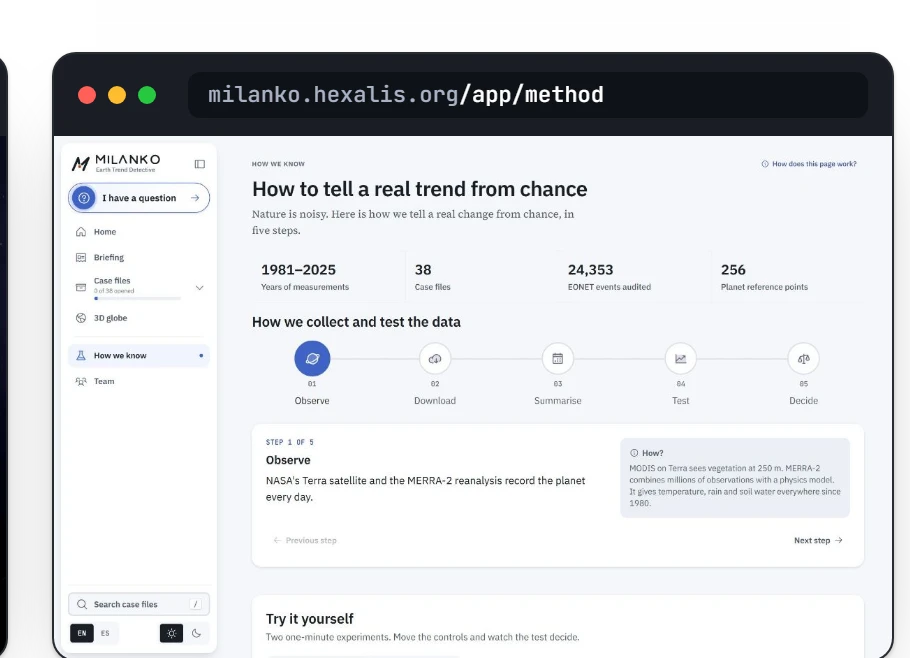
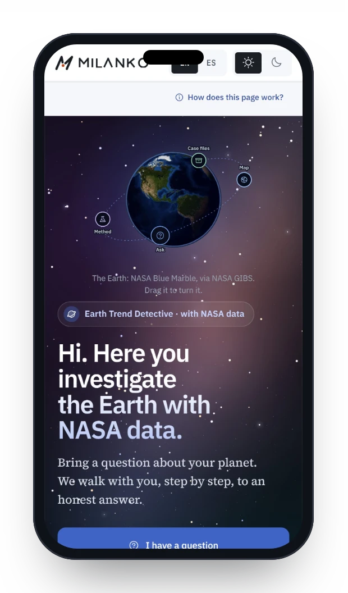
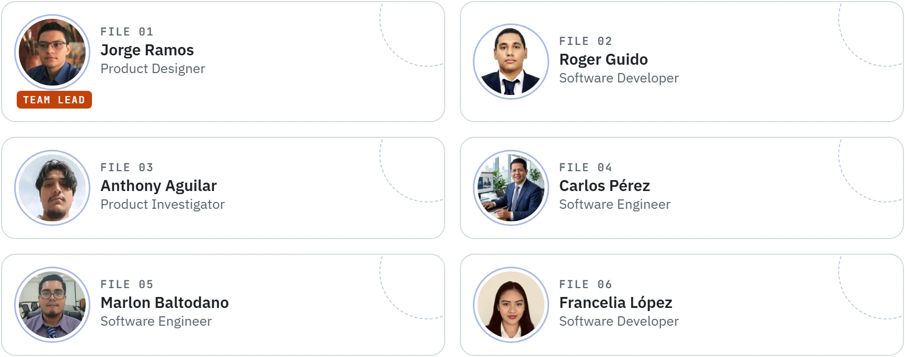

<div align="center">

<picture>
  <source media="(prefers-color-scheme: dark)" srcset="docs/assets/readme/hero-dark.svg">
  
</picture>

<br>

<a href="https://milanko.hexalis.org/app"></a>
<a href="https://www.spaceappschallenge.org/"></a>
<a href="https://milanko.hexalis.org/app"></a>

[**Try it live →**](https://milanko.hexalis.org/app) &nbsp;·&nbsp; [How we know](https://milanko.hexalis.org/app/method) &nbsp;·&nbsp; [The team](https://milanko.hexalis.org/app/team) &nbsp;·&nbsp; [Developer guide](docs/development.md)

</div>

## Why Milanko?

Headlines say _"record heat"_ and _"more disasters than ever"_. Nature is noisy: one hot summer is not a warming trend, and more storms on a list may only mean more counting. **Milanko turns 45 years of NASA measurements into a detective game**: anyone, a 12-year-old, a curious adult or a scientist, asks a question and finds out, with a real statistical test, whether the change is **real or just chance**.

<picture>
  <source media="(prefers-color-scheme: dark)" srcset="docs/assets/readme/figures-dark.png">
  
</picture>

## Investigate like a detective

Pick **what** and **where**, and Milanko walks you through eight short steps, from a question to a verdict you can check yourself.

<picture>
  <source media="(prefers-color-scheme: dark)" srcset="docs/assets/readme/journey-dark.png">
  
</picture>

<table>
<tr>
<td width="50%" valign="top">

<p align="center"><b>Make a hypothesis, then let the data answer.</b><br><sub>Your bet against the trend line, and what the test really says.</sub></p>
</td>
<td width="50%" valign="top">

<p align="center"><b>Every case file ends in a verdict.</b><br><sub>Plain words first; Mann-Kendall and Theil-Sen right below.</sub></p>
</td>
</tr>
<tr>
<td width="50%" valign="top">

<p align="center"><b>Spin the whole planet.</b><br><sub>Case files, NASA events, live weather and data layers on a 3D globe.</sub></p>
</td>
<td width="50%" valign="top">

<p align="center"><b>Open science, no black box.</b><br><sub>Five steps, two hands-on labs and every limit said plainly.</sub></p>
</td>
</tr>
</table>

### Made for every screen and every reader

- Fully bilingual, **English and Español**, switchable at any time.
- A _"How does this page work?"_ guided tour on every page.
- Light and dark themes, and reduced motion.
- Keyboard and screen-reader friendly, audited with axe.

<p align="center"></p>

## Honest by design

<picture>
  <source media="(prefers-color-scheme: dark)" srcset="docs/assets/readme/principles-dark.png">
  
</picture>

## Built on NASA open data

| Source                                                      | What it gives us                                             |
| ----------------------------------------------------------- | ------------------------------------------------------------ |
| [**NASA POWER · MERRA-2**](https://power.larc.nasa.gov/)    | Daily temperature, rain and soil water everywhere since 1981 |
| [**MODIS / Terra · ORNL DAAC**](https://modis.ornl.gov/)    | Vegetation (NDVI) seen from orbit at 250 m                   |
| [**NASA EONET v3**](https://eonet.gsfc.nasa.gov/)           | Natural events: wildfires, storms, floods, volcanoes         |
| [**NASA GIBS**](https://nasa-gibs.github.io/gibs-api-docs/) | Satellite imagery and the Blue Marble Earth                  |

## Under the hood


Server Components read the Milanko API; every view keeps its filters in the URL, so any screen can be shared. Every push passes the same gate locally and in CI (format, lint, types, 500+ tests and dead-code checks) before it ships to production.

```bash
git clone https://github.com/hexalis/milanko-frontend.git && cd milanko-frontend
pnpm install            # fetches the exact Node version and installs the Git hooks
cp .env.example .env.local
pnpm dev                # → http://localhost:3000
```

Architecture, environments, scripts and conventions live in the **[developer guide](docs/development.md)** (Spanish).

## The team

Built for the **2026 NASA Space Apps Challenge**, _"Be An Earth System Trend Detective!"_

<picture>
  <source media="(prefers-color-scheme: dark)" srcset="docs/assets/readme/team-dark.webp">
  
</picture>

<div align="center">

A **[Hexalis](https://hexalis.org)** project · _Knowledge is universal._

<sub>Milanko is an independent project for NASA Space Apps 2026. It uses public NASA data; it is not an official NASA app.<br>
We used Claude (Anthropic) to help write code, draft copy and review statistics; every number comes from NASA data processed by our open scripts.</sub>

</div>
