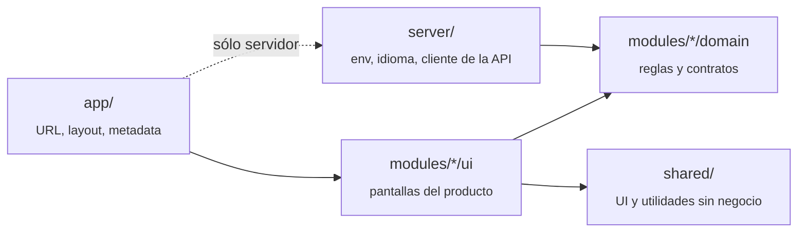

# Guía de desarrollo · Milanko frontend

> La presentación del producto está en el [README](../README.md). Esta guía es para quien va a tocar el código.

Frontend en Next.js de **Milanko · Earth Trend Detective**: qué cambia en la Tierra, dónde, cuánto y si el cambio es estadísticamente significativo. Todos los números vienen de datos públicos de NASA (POWER, MODIS vía GIBS y EONET), persistidos y servidos por la API de Milanko.

- **Producción:** [milanko.hexalis.org/app](https://milanko.hexalis.org/app)
- **Stack:** Next.js 16 · React 19 · TypeScript · Tailwind CSS 4
- **Runtime:** Node 24.20.0 · pnpm 12.14.0
- **Barrera de calidad:** `pnpm check`, en local, en el hook `pre-push` y en CI

**Contenido:** [Arranque](#arranque-en-2-minutos) · [Mapa del producto](#mapa-del-producto) · [Ambientes y API](#ambientes-y-api) · [Arquitectura](#arquitectura) · [Calidad](#calidad-shift-left) · [Ramas y despliegue](#ramas-y-despliegue) · [Reglas](#reglas-del-repositorio) · [Problemas frecuentes](#problemas-frecuentes)

## Arranque en 2 minutos

```bash
corepack enable                 # o: npm install --global pnpm@12.14.0
git clone git@github.com:hexalis/milanko-frontend.git && cd milanko-frontend
pnpm install                    # descarga Node 24.20.0 si falta e instala los hooks de Git
cp .env.example .env.local
pnpm dev                        # → http://localhost:3000
```

- No hace falta `nvm use`: `devEngines.runtime` en `package.json` hace que pnpm use Node 24.20.0 exacto. `.nvmrc` queda para editores y CI.
- pnpm sólo instala versiones publicadas hace al menos 24 h (`minimumReleaseAge` en `pnpm-workspace.yaml`).
- Opcional: instala [gitleaks](https://github.com/gitleaks/gitleaks#installing) para revisar secretos al hacer commit. CI lo ejecuta siempre.

### Comandos del día a día

| Comando                         | Para qué                                                            |
| ------------------------------- | ------------------------------------------------------------------- |
| `pnpm dev`                      | Servidor local con Turbopack.                                       |
| `pnpm check`                    | **La definición de "listo"**: formato, lint, tipos, tests y Knip.   |
| `pnpm test` · `pnpm test:watch` | Pruebas unitarias y de componentes (Vitest).                        |
| `pnpm test:e2e`                 | Recorridos de navegador en Chromium (Playwright).                   |
| `pnpm format` · `pnpm lint:fix` | Corrige el formato (Oxfmt) y lo que Oxlint arregla solo.            |
| `pnpm typecheck`                | `next typegen` + TypeScript. Oxc no sustituye esta comprobación.    |
| `pnpm knip`                     | Informe de código y dependencias sin uso. Revísalo antes de borrar. |
| `pnpm api:types`                | Regenera los tipos de la API desde el OpenAPI de develop.           |
| `pnpm build` · `pnpm start`     | Build de producción y servidor de ese build.                        |

## Mapa del producto

| Ruta                           | Qué es                                                             | Módulo     |
| ------------------------------ | ------------------------------------------------------------------ | ---------- |
| `/`                            | Portada: la Tierra y sus cuatro puertas                            | `ask`      |
| `/ask` · `/ask/[qid]`          | "Tengo una pregunta": motor de reglas y lección guiada de 8 pasos  | `ask`      |
| `/ask/compare`                 | Dos lugares lado a lado, cada uno con su veredicto                 | `ask`      |
| `/briefing`                    | Método del equipo: la auditoría EONET y cómo se arma un expediente | `cases`    |
| `/cases` · `/cases/[id]`       | Archivo de expedientes y cada expediente con su veredicto          | `cases`    |
| `/cases/[id]/data`             | Descarga CSV de la serie del expediente                            | `cases`    |
| `/explore`                     | Globo 3D con expedientes, eventos NASA, clima en vivo y capas      | `explore`  |
| `/method`                      | Cómo lo sabemos: cinco pasos, dos laboratorios y los límites       | `method`   |
| `/team`                        | El equipo                                                          | `team`     |
| `/regions` · `/rankings`       | Explorador de regiones y Planet Pulse                              | `regions`  |
| `/regions/[code]/observations` | Descarga CSV de la serie de una región                             | `regions`  |
| `/events` · `/events/[id]`     | Archivo EONET y contexto de cada evento                            | `events`   |
| `/coverage`                    | Inventario de variables persistidas                                | `coverage` |

Módulos que cruzan todo el producto:

- **`workspace`**: el marco común (menú lateral, barra inferior en móvil, búsqueda y preferencias).
- **`copy`**: los textos en inglés y español (`data/messages.{en,es}.json`). El idioma sale de la cookie y, en la primera visita, del navegador (`src/server/locale.ts`).
- **`tour`**: los recorridos guiados con Driver.js. Cada paso apunta a un ancla `data-tour` y su texto vive en `copy` como `tour.<id>.<n>.t` / `.d`. Si el ancla no está visible, el paso se omite.

El globo de `/explore` es un visor 3D independiente en `public/globe/` (fuera del lint). Corre en un `iframe` aislado y habla con la página por `postMessage`.

## Ambientes y API

| Ambiente   | Rama      | URL                               | API                                      |
| ---------- | --------- | --------------------------------- | ---------------------------------------- |
| develop    | `develop` | `https://dev-milanko.hexalis.org` | `https://dev-milanko.hexalis.org/api/v1` |
| qa         | `qa`      | `https://qa-milanko.hexalis.org`  | `https://qa-milanko.hexalis.org/api/v1`  |
| production | `main`    | `https://milanko.hexalis.org`     | `https://milanko.hexalis.org/api/v1`     |
| poc        | —         | `https://milanko-poc.hexalis.org` | `https://milanko-poc.hexalis.org/api/v1` |

| Variable          | Qué hace                                                                                      |
| ----------------- | --------------------------------------------------------------------------------------------- |
| `MILANKO_API_URL` | API que llama el servidor de Next. Por defecto, develop. En el VPS apunta al backend interno. |
| `MILANKO_API_KEY` | Sólo si el servidor usa la API pública en lugar de la interna.                                |
| `APP_ENV`         | `local · develop · qa · production`. Se lee en cada petición: un mismo build sirve a todos.   |
| `NEXT_BASE_PATH`  | Prefijo del despliegue (`/app`). Se fija al construir la imagen; en local va vacío.           |

- `src/server/env.ts` valida las variables al usarlas y falla con un mensaje claro si alguna está mal.
- El navegador sólo pide al mismo origen `/api/v1`. En los ambientes desplegados lo resuelve nginx; en local, el `rewrite` de `next.config.mjs`.
- Los tipos de la API (`src/server/integrations/milanko-api/schema.d.ts`) salen del OpenAPI con `pnpm api:types`. Regenéralos cuando cambie la API.
- Los expedientes y la auditoría de eventos se sirven desde `src/modules/cases/data/*.json`, generados a partir de datos de NASA.

## Arquitectura



```text
src/
├─ app/        # Rutas, layouts, metadata y handlers. Conoce las URLs, nada más.
├─ modules/    # Una carpeta por capacidad del producto (ver el mapa de arriba)
│  └─ <módulo>/  ui/ · domain/ · data/ · hooks/ · actions.ts   ← sólo las que existan
├─ shared/     # ui/, lib/ y hooks/ sin vocabulario de negocio
└─ server/     # Entorno, idioma y adaptadores privados (sólo servidor)
```

- Los datos se cargan en **Server Components**; el cliente sólo hidrata lo interactivo.
- Los **filtros viven en la URL**, así que cualquier vista se puede compartir.
- **Oxlint hace cumplir los límites**: `shared` no importa `app`, `modules` ni `server`; un módulo no importa `app`, y entre módulos sólo se usa `@/modules/<módulo>` (su `index.ts`), nunca sus rutas internas.
- Un componente cliente nunca importa `src/server`.
- Las carpetas son permitidas, no obligatorias: no se crean directorios vacíos ni capas "por si acaso".

La guía completa está en [architecture.md](architecture.md).

## Calidad shift-left

Cada control corre lo antes posible, y CI repite exactamente el comando que ya corriste en local.

| Momento        | Qué corre                                                                    |
| -------------- | ---------------------------------------------------------------------------- |
| `pnpm install` | Node exacto, dependencias con 24 h o más de publicadas, hooks instalados     |
| `pre-commit`   | Oxfmt y Oxlint sobre los archivos staged, gitleaks                           |
| `commit-msg`   | Conventional Commits (`tipo(alcance): resumen`)                              |
| `pre-push`     | `pnpm check`: format:check → lint → typecheck → test → knip                  |
| CI             | `pnpm check` y build; E2E en pull requests; imagen y despliegue en cada rama |

- Las pruebas unitarias van **junto al archivo** que cubren (`<archivo>.test.tsx`). `tests/e2e` queda para recorridos de navegador, incluida la revisión de accesibilidad con axe.
- Un control nuevo se añade como script dentro de `check`, no como un paso suelto de CI.
- Nunca `git commit --no-verify` ni desactivar reglas de Oxlint para pasar un hook: se corrige la causa.

Más detalle en [shift-left.md](shift-left.md) y en la [auditoría](audit.md).

## Ramas y despliegue

```text
rama de trabajo ──PR──▶ develop ──▶ qa ──▶ main
                           │          │       │
                     dev-milanko  qa-milanko  milanko.hexalis.org
                     (cada push despliega su ambiente automáticamente)
```

- El pipeline (`.github/workflows/pipeline.yml`) corre las verificaciones, construye la imagen standalone con `NEXT_BASE_PATH=/app` y la publica en `ghcr.io`; el VPS sólo la descarga y reinicia el contenedor.
- **Un push a `main` es un despliegue a producción.**
- Ambientes, variables y secretos de GitHub: [deployment.md](deployment.md).

## Reglas del repositorio

Antes de crear o mover código, lee [`AGENTS.md`](../AGENTS.md) y las skills [`next-modular-architecture`](../.codex/skills/next-modular-architecture/SKILL.md) y [`tailwind-component-creation`](../.codex/skills/tailwind-component-creation/SKILL.md). Valen para personas y para agentes.

- **Sin carpetas genéricas**: aquí no existen `src/components`, `src/services`, `src/utils`, `src/features` ni `src/store`.
- **Tailwind estático**: las clases van completas junto al componente, nunca `bg-${color}-500`. `tailwind-variants` sólo para variantes semánticas y estables (`intent`, `size`, `tone`). Sin `tailwind-merge`.
- **Textos en `copy`**, en inglés y español.
- **Tours**: si mueves o renombras un ancla `data-tour`, actualiza `src/modules/tour/domain/tours.ts`.
- **Commits** con Conventional Commits. Sólo `pnpm`; nunca `package-lock.json`.

## Problemas frecuentes

| Síntoma                                                 | Solución                                                                      |
| ------------------------------------------------------- | ----------------------------------------------------------------------------- |
| `UND_ERR_CONNECT_TIMEOUT` al llamar a la API            | Red con IPv6 incompleto: `NODE_OPTIONS=--dns-result-order=ipv4first pnpm dev` |
| Los hooks fallan con `pnpm: command not found`          | `corepack enable` y abre una terminal nueva.                                  |
| Errores de tipos de la API tras un cambio en el backend | `pnpm api:types` y vuelve a correr `pnpm typecheck`.                          |
| `pnpm test:e2e` no encuentra el navegador               | `pnpm exec playwright install chromium`                                       |

## Origen

El repositorio nace de la plantilla [`hexalis/template-nextjs-apps`](https://github.com/hexalis/template-nextjs-apps) ([cómo se usa](using-this-template.md)) y migró por fases la POC estática [`hexalis/poc-research-design-concept`](https://github.com/hexalis/poc-research-design-concept) (rama `develop`, commit `0280b3e`). La migración está completa: todas las vistas de la POC viven ya en este frontend.
